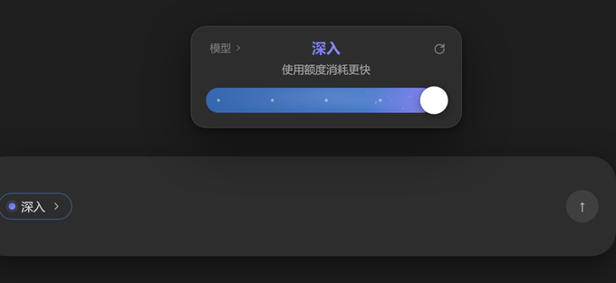
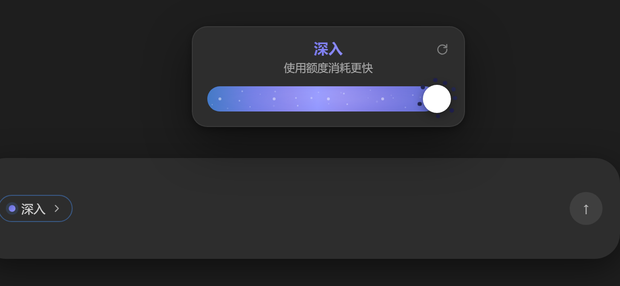

# dsh-codex-power-slider

> 给 **DeepSeek Harness** 的 Web GUI 装上 OpenAI Codex 风格的「思考强度电源滑块」：
> composer 里一颗胶囊，点开就是一张浮层卡片 —— 顶部当前档位、中部模型名（可下钻模型列表）、
> 底部圆点刻度滑杆；最高档是蓝紫渐变 + 星点粒子。
>
> 数据全部是 **DSH 真实会话数据**：档位来自当前模型适配器公布的 reasoning efforts，
> 模型来自会话模型目录，拖动即调用 `remote.session.selectModel`，下一次请求立即生效。

## 效果

| 最低档（轻度） | 最高档：起手 0.34s（紫色快速出来一点） | 最高档：切入后 1.6s 内显示额度提醒 | 最高档：提醒淡出后回到模型名 |
|---|---|---|---|
|  |  |  |  |

模型列表（按提供方分组、悬停浮出说明气泡）：


> 上面五张是用离线 harness 把 `lib/client.js` 挂到假 DSH 宿主上真实渲染、再由 Edge 无头截的图
> （渲染脚本见工作区 `tools/preview-render.mjs`，不在本包内）。第二张是把扫描动画**暂停**在
> 0.336s（两段式里「快速起手」的终点）；第三、四张是同一个页面在**真等 1.6s 计时器跑完**前后的
> 两个状态，用来证明提醒确实会自己淡回模型名。

```
┌──────────────────────────────────────┐
│                              ↺       │   ← 恢复该模型默认档位
│              轻度                    │   ← 当前档位（最高档是蓝紫渐变 + 星点）
│            6.1 Sol ›                 │   ← 当前模型，点开模型列表
│  ●────────○──────○──────○──────○     │   ← 圆点刻度 + 白色拖柄
└──────────────────────────────────────┘
              [ 轻度 ▾ ]                     ← composer 工具条里的触发器
```

## 最高档（Ultra）的动效

切到最高档不是「换个颜色」，而是一段 2.4s 的动效：

- **起手快、后面慢**：紫色从右边缘向左扫过，但**分两段走** —— 前 14% 的时间（约 0.34s）
  先把紫色快速推出来一小截（约轨道右侧 30%），剩下 86% 的时间再慢慢铺满。
  用**逐关键帧的 `animation-timing-function`** 实现：两段各自有自己的缓动曲线，
  所以起手是「平稳地快」而不是硬弹。
- **紫色从右边缘向左扫过**：一条 2 倍宽的材质（左半基础蓝、右半紫蓝本体），靠
  `background-position` 把取景窗从右往左推。用 `background-position` 而不是位移裁切，
  是因为它的插值在任何 Chromium 上都一定平滑；两半渐变在基础蓝 `#447ac6` 处**颜色接续**，
  所以扫描前沿是一道柔和过渡，不是一刀切。
- **粒子跟着蔓延**：24 颗浮尘长在材质层里，用同一套两段式节奏做 `clip-path` 揭示，
  「紫到哪儿、粒子到哪儿」，不是一开始就铺满。
- **粒子会飘（不是只闪）**：每颗浮尘挂在两层锚点上，**X / Y 各跑一个独立周期**
  （X 10–23s、Y 7.5–18s，均 `ease-in-out` 闭合往返），合成弯曲轨迹 —— 既不是直线往返，
  也不会全体同步；粒子自身只做 5.3–9.1s 的**呼吸**（最低降到峰值的 60–78%），不再闪烁。
- **兴奋的抖动**：其中 **14/24 颗**跑一层「轻推—回弹—歇一会儿」的抖动 —— 每周期**两次不等强**
  脉冲（次脉冲只有主脉冲的 45–60%），单颗实际运动只占周期 20–28%，其余时间静止。
  位移按景深给（**径向**距离、方向随机）：远景 0.30–0.50px、中景 0.55–0.85px、
  近景 0.90–1.15px；**不联动明暗与尺寸**，否则就从浮尘变成噪点。
- **拖柄周围溅出一圈墨点**：滑到最高档那一下，拖柄边缘向外溅出 **8 颗深蓝紫墨点**
  （`#20204f`–`#252851`，比卡片底更暗、更蓝 —— 原版就是这个材质语言，不是发光白点），
  260ms 错峰落定后**静止保留**，退出最高档时 120ms 淡出。半径与点径按拖柄直径等比缩放
  （基准是原版 46px 拖柄量到的：半径 28–32px、点径约 7px）。
- **三层景深**：18 颗远景（0.85–1.6px 小而实）、4 颗中景（1.8–2.6px，小实核 + 软边）、
  2 颗近景（3.0–3.6px，大而虚）。用径向渐变软边代替动态 `blur`，静态绘制、只动
  `transform / opacity`。
- **材质里有光**：两层静态径向柔光，其中一层以 11.7s 缓慢呼吸，负责「材质发光」而不是
  「白点堆叠」。
- **最高档的额度提醒**：滑到最高档就显示 **「使用额度消耗更快」**（原版文案；纯文本、不可点、
  无警示色），**1.6s 后原位交叉淡化 120ms** 回到可点的模型名。拖动预览一到那一档就亮，
  不用松手确认、也不等写入往返；离开最高档立刻收起。
- **尊重系统设置**：`prefers-reduced-motion: reduce` 时停掉全部动效（含墨点环入场与交叉淡化）。

> 这一版的审美方向与参数都由 **gpt-6.1-sol** 给出（差距诊断、参数表、复审收口、
> 抖动设计与克制边界、额度提醒排版）；落地时材质色仍是按参考图逐像素采样的结果，
> 并把它建议的「钉住材质」裁切换回滑动渐变，以保住原版那条柔和的前沿。

## 特性

- **真实生效**：拖动滑杆写入会话的 `reasoningEffort`，与 DSH 原生模型菜单共用同一份
  会话选择状态；两边随时保持一致（原生菜单改了，卡片跟着变，反之亦然）。
- **按模型自适应**：每个模型支持几档、叫什么、默认哪一档，全部读适配器元数据。
  模型可选项不足时不显示滑杆，不会造出不存在的档位。
- **零构建**：`lib/client.js` 是手写的单文件经典脚本，宿主直接读取字节下发，
  不需要 tsdown / rollup / pnpm build。
- **零 Node 依赖**：Node 半边是空插件，不注册服务、不开 HTTP 路由、不注入 index，
  因此不会和其它插件抢 `webServer` / index 注入通道。
- **跟随主题**：暗色取色对齐 Codex 原版，亮色走 `body:not([data-ds-dark-theme])` 覆盖，
  同时尽量复用 `--dsw-alias-*` 语义 token。
- **键盘可用**：`↑ ↓ ← →` 调整档位，`Esc` 退出模型列表 / 关闭卡片，
  `role="slider"` + `aria-valuetext` 完整无障碍语义。

## 安装

### 方式一：本地开发（link）

```powershell
# 1. 把包放进 profile（绝对路径）
dsh plugin --profile desktop add link:C:\path\to\dsh-codex-power-slider
```

等价的手工做法（`dsh` CLI 不可用时）：

1. 在本机 profile 目录 `%DSH_HOME%\profiles\desktop` 下：
   - `package.json` 的 `dependencies` 增加
     `"dsh-codex-power-slider": "link:C:\\path\\to\\dsh-codex-power-slider"`；
   - `dsh.profile.bundles` 数组追加 `"dsh-codex-power-slider"`；
2. 在同目录执行 `pnpm install`；
3. 让 DSH 重新加载插件树（重启应用，或在「设置 → 插件」里重新启用一次）。

只想临时挂载、不改 `bundles` 时，也可以直接在本 profile 的补丁层
`cordis.patch.yml` 末尾追加：

```yaml
- insert:
    - id: dsh-codex-power-slider
      name: dsh-codex-power-slider
```

### 方式二：npm

```powershell
dsh plugin --profile desktop add dsh-codex-power-slider
```

### 卸载

```powershell
dsh plugin --profile desktop remove dsh-codex-power-slider
```

## 使用

| 操作 | 效果 |
|---|---|
| 点工具条里的胶囊 | 打开 / 关闭卡片 |
| 点卡片中间的模型名 `›` | 进入模型列表（按提供方分组，当前项打勾） |
| 鼠标悬停模型行 | 右侧浮出该模型的说明气泡 |
| 拖动滑杆 / 点轨道 | 切换推理强度，松手即提交 |
| 点右上角 `↺` | 回到该模型的默认推理强度 |
| `↑` `↓` `←` `→` | 焦点在滑杆上时逐档切换 |
| `Esc` | 模型列表 → 卡片 → 关闭 |

**切到最高档后的 1.6 秒**，第二行会被临时额度提醒占用（不可点）；这段时间里模型入口不可用，
1.6 秒后自动恢复 —— 与 Codex 原版一致。提醒期间不重播、不阻塞输入，也不会有「点它却跳到模型列表」
的语义错位。

## 工作原理

```
composer 工具条
  conversation.input.left  ← 空闲的 list slot（session 作用域）
        │  ctx.slots.inject + ctx.slots.register
        ▼
  <dsh-codex-power-slider>  ──portal──▶  document.body（浮层卡片 + 说明气泡）

读：ctx.sessions.binding(sessionId).session.projections.faceOf('modelSelection')
      → { lastUsed, next }        ← 与原生模型菜单共用同一份投影
列：ctx.remote.session.modelCatalog()
      → groups[].models[].reasoning.{ efforts[{id,name,description}], defaultEffort }
写：ctx.remote.session.selectModel({ sessionId, provider, model, reasoningEffort })
      → RemoteResult；失败码 session/writer-held 会提示「会话被占用」
```

关键实现约束（第三方 client 插件通用）：

- 浏览器半边必须是**经典脚本**：顶层同步 `window.__ModuleLoader__.load({ id, factory })`，
  不能出现 `import` / `export`；`id` 必须等于包名。
- `factory(require)` 只能 require 平台种子：`react`、`react-dom`、`react/jsx-runtime`、
  `@deepseek-ai/cordis`、`@deepseek-ai/dsh-client-store`、`@deepseek-ai/dsh-client-ui-slots`、
  `@deepseek-ai/dsh-client-ui-primitives`、`@deepseek-ai/dsh-client-ui-dockkit`。
- `package.json` 必须有 `dsh.client.platform === "web"` 与 `exports["./client"]`，
  且 `name` 必须与 `cordis.patch.yml` 里 `insert.name` 完全一致 —— 不一致会被**静默跳过**。
- 子 slot 必须等声明：`ctx.slots.inject(name, cb)`，直接 `register` 会抛
  `slot "…" is not declared`。

## 档位文案对照

DSH 适配器返回的 `effort.name` 永远优先。只有当适配器只给出 id（没有本地化名字）时，
才回落到 Codex 原版中文文案：

| effort id | 显示 | 完整名 | 说明 |
|---|---|---|---|
| `none` / `min` / `minimal` | 轻度 | 快速思考 | 提供快速且深思熟虑的回复 |
| `low` / `light` | 标准 | 思考中 | 平衡思考时间与回复速度 |
| `standard` / `medium` | 深度 | 进阶思考 | 延长思考时间以处理复杂问题 |
| `high` / `extended` / `xhigh` | 极高 | 极高 Thinking | 适用于复杂问题的极高推理深度 |
| `max` | 深入 | 深度思考 | 针对高难度问题提供更深入的分析 |
| `ultra` | Ultra | Ultra | 针对高难度问题提供更深入的分析 |

最高档（且该模型 ≥ 3 档）会切换成蓝紫渐变 + 星点粒子的「Ultra」皮肤。

## 限制

- 只对**普通会话**生效；被寻址的 subagent 会话不公开模型选择（DSH 侧的约束）。
- 目录里没有模型、或模型没有任何 reasoning 元数据时，滑杆不显示，胶囊退化为只读。
- 会话被其它 DSH 写句柄占用时提交会失败，卡片下方显示错误文案（对应
  `session/writer-held`）。
- 卡片宽度固定 282px（拖柄 29px / 轨道高 26px / 标题 15px）；窗口过窄时会自动左右夹紧，不会跑出视口。

## 开发与预览

仓库根目录之外还有一个离线预览 harness（不在本包内），用 Edge 无头模式把
`lib/client.js` 挂到假的 DSH 宿主上截图，用于在没有 GUI 的环境里检查视觉：

```powershell
# 需要同时存在 preview/ 目录（含 React UMD 与 harness.html）
powershell -File preview\shot.ps1 preview\harness.html preview\out\plugin.png
```

改完 `lib/client.js` 直接刷新页面即可生效 —— 宿主按 `mtimeMs/ctimeMs/size` 算 revision，
变化会通过 SSE 推 `rebuilt` 帧；只有替换或移除 `dsh-client-modules` 本身才需要整页刷新。

## 许可

MIT，见 [`LICENSE`](LICENSE)。素材与来源说明见 [`PROVENANCE.md`](PROVENANCE.md)。
